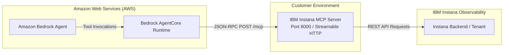

# Amazon Bedrock

The IBM Instana Observability MCP Server enables **Amazon Bedrock** foundation models and AI agents to query real-time infrastructure metrics, application topology, incidents, SLOs, and observability intelligence using the Model Context Protocol (MCP).

---

## Architecture Overview



---

## Prerequisites

Before getting started, ensure you have:
1. An **AWS Account** with Amazon Bedrock enabled in your preferred region (e.g. `us-east-1`).
2. An **IBM Instana Instance URL** (e.g., `https://your-tenant.instana.io`).
3. An **Instana API Token** with appropriate read permissions.

---

## Deployment via AWS Marketplace

1. Navigate to the [AWS Marketplace](https://aws.amazon.com/marketplace) and search for **IBM Instana Observability MCP Server**.
2. Click **Subscribe** (Free listing).
3. Under the deployment options, choose **Amazon Bedrock AgentCore**.
4. Configure your container environment variables:
   - `INSTANA_BASE_URL`: Base URL of your Instana tenant (e.g. `https://your-tenant.instana.io`).
   - `INSTANA_API_TOKEN`: Your Instana API Token with read permissions.
   - `PORT`: `8000` (default).
5. Click **Deploy**. AWS automatically provisions the serverless container runtime in your AWS account and generates your **Agent Runtime ARN**.

*(For running or building custom Docker containers locally, see the [Docker Deployment Guide](../../DOCKER.md)).*

---

## Connecting to Amazon Bedrock Agents

1. Open the **Amazon Bedrock Console** $\rightarrow$ **Agents** $\rightarrow$ Click **Create Agent** (or select an existing agent).
2. Choose your base foundation model (e.g., Anthropic Claude 3.5 Sonnet).
3. In the **Action Groups** section, click **Add Action Group**.
4. Set **Action Group Type** to **Model Context Protocol (MCP)**.
5. Provide your **Bedrock AgentCore Runtime ARN** (from Method 1).
6. Amazon Bedrock will automatically discover all 12 unified smart router tools:

| Tool Name | Scope & Purpose |
|---|---|
| `manage_applications` | Query traces, service call metrics, latency percentiles, and application perspectives |
| `manage_infrastructure` | Query hosts, containers, processes, topologies, and GenAI / LLM entity metrics |
| `manage_events` | Discover open incidents, issues, changes, and root cause analysis (RCA) |
| `manage_synthetics` | Monitor synthetic tests, PoP health, playback metrics, and synthetic smart alerts |
| `manage_websites` | Analyze browser page loads, user beacons, and website performance |
| `manage_mobile_apps` | Inspect mobile beacons, crash metrics, and session replay events |
| `manage_slo` | Track service level objectives, error budget burn rates, and SLO reports |
| `manage_alert_channels` | Discover and manage notification channels (Slack, Email, Webhooks, PagerDuty, etc.) |
| `manage_releases` | Track deployments, release markers, and post-release performance impact |
| `manage_maintenance_windows` | View and manage scheduled maintenance windows |
| `manage_automation` | Browse action catalogs and action execution history |
| `manage_custom_dashboards` | Create and query custom dashboard configurations |

---

## Example Prompts for Bedrock Agents

Once connected, your Bedrock Agent can answer operational and diagnostic questions directly:

```text
"Are there any open critical incidents in the last 30 minutes in Instana?"
```

```text
"What is the P95 latency and throughput for the payment-service over the past 1 hour?"
```

```text
"Check the SLO error budget and current burn rate for our checkout service."
```

```text
"Show me the top 5 hosts with the highest CPU utilization in our production cluster."
```

```text
"List any failing Synthetic tests and their target datacenter locations."
```

---

## Monitoring & CloudWatch Logs

When running on Amazon Bedrock:
- **CloudWatch Logs**: View container execution logs under `/aws/bedrock-agentcore/runtimes/<AGENT_ID>-DEFAULT`.
- **GenAI Observability Dashboard**: Access the [AWS CloudWatch GenAI Observability Console](https://console.aws.amazon.com/cloudwatch/home?region=us-east-1#gen-ai-observability/agent-core) for real-time invocation latency, token consumption, and tool execution metrics.
