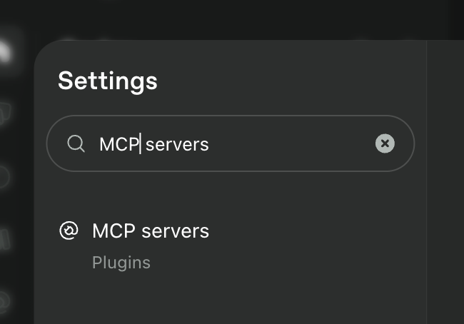
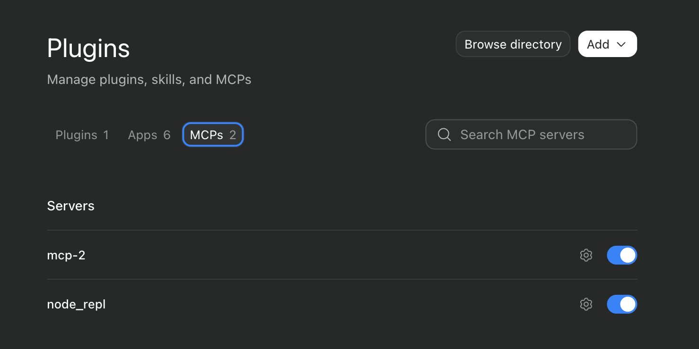
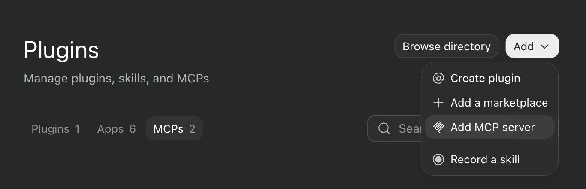
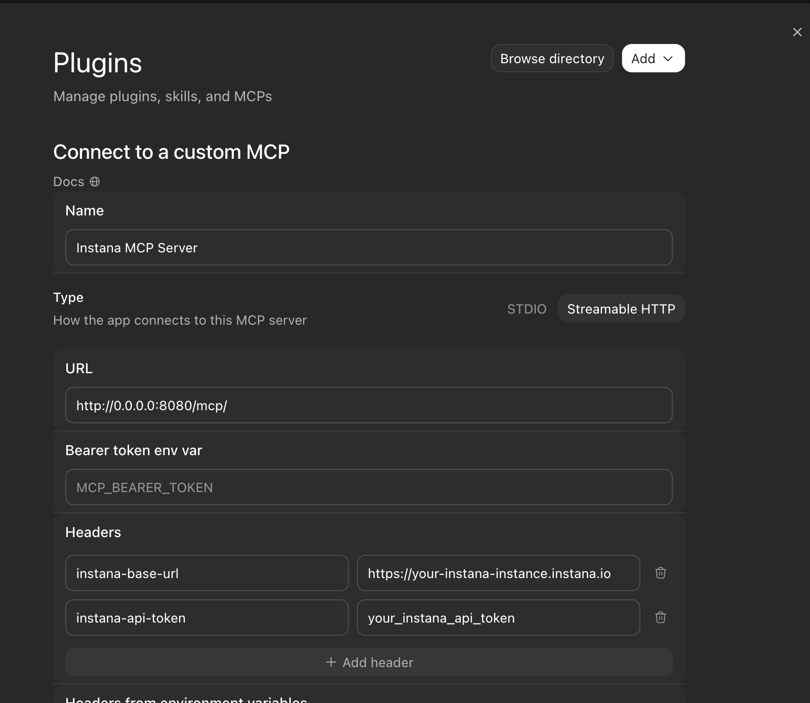
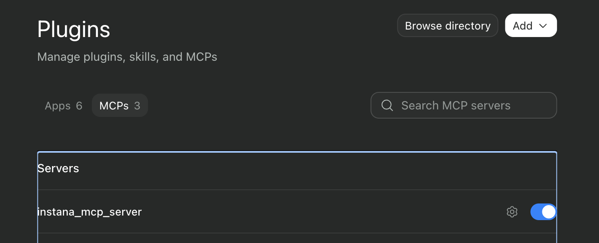
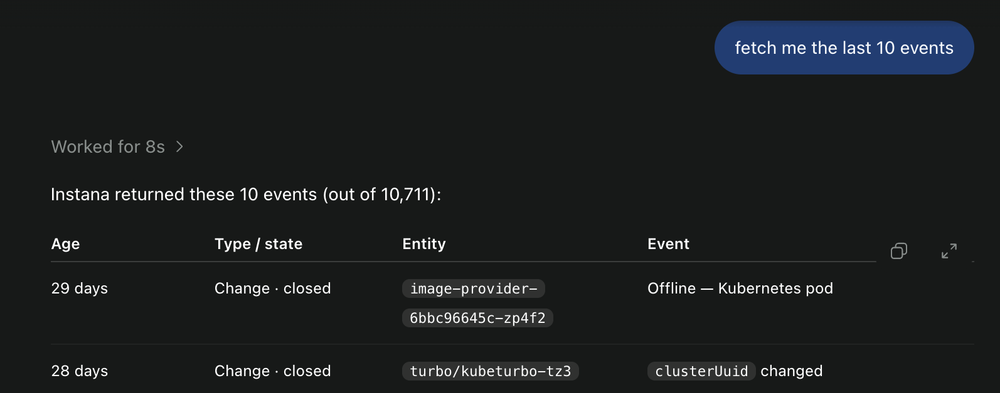
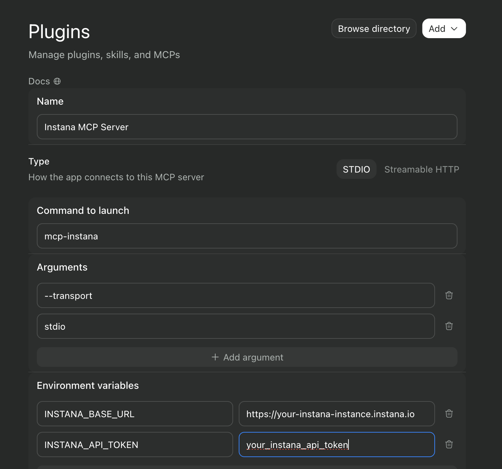

## ChatGPT Desktop

ChatGPT Desktop supports both Streamable HTTP and STDIO modes for MCP integration.

### Open the MCP Server Settings

1. Download and install ChatGPT Desktop, then launch the app.
2. Click **Settings**.
3. In the settings search bar, search for `mcp servers` and click the **MCP servers** result. The **Plugins** page opens.

   

4. Click the **MCPs** tab to see the MCP servers that are currently configured.

   

5. Click **Add** (top right), then click **Add MCP server** in the drop-down.

   

6. On the **Connect to a custom MCP** page, configure the server using one of the modes below.

### Streamable HTTP Mode

The Streamable HTTP mode provides a REST API interface for MCP communication using JSON-RPC over HTTP.

**Step 1: Start the MCP Server in Streamable HTTP Mode**

Before configuring ChatGPT Desktop, you need to start the MCP server in Streamable HTTP mode. Please refer to the [Starting the Local MCP Server](../../README.md#starting-the-local-mcp-server) section for detailed instructions.

```
mcp-instana --transport streamable-http
```

**Step 2: Configure ChatGPT Desktop**

On the **Connect to a custom MCP** page, select the **Streamable HTTP** type and enter the following:

| Field | Value |
|-------|-------|
| **Name** | `Instana MCP Server` |
| **Type** | `Streamable HTTP` |
| **URL** | `http://localhost:8080/mcp/` |
| **Headers** | Key: `instana-base-url`, Value: `https://your-instana-instance.instana.io` |
| | Key: `instana-api-token`, Value: `your_instana_api_token` |

Leave the other fields (such as **Bearer token env var** and **Headers from environment variables**) empty, then save.



**Step 3: Test the Connection**

The Instana MCP Server should now appear in the **MCPs** tab:



You can now run queries in ChatGPT Desktop:

```
fetch me the last 10 events
```



### Stdio Mode

**Configuration using CLI (PyPI Installation - Recommended):**

On the **Connect to a custom MCP** page, select the **STDIO** type and enter the following:

| Field | Value |
|-------|-------|
| **Name** | `Instana MCP Server` |
| **Type** | `STDIO` |
| **Command to launch** | `mcp-instana` |
| **Arguments** | `--transport` |
| | `stdio` |
| **Environment variables** | Key: `INSTANA_BASE_URL`, Value: `https://your-instana-instance.instana.io` |
| | Key: `INSTANA_API_TOKEN`, Value: `your_instana_api_token` |

Add each argument with **Add argument** and each variable with **Add environment variable**. Leave **Environment variable passthrough** and **Working directory** empty.



**Note:** If you encounter "command not found" errors, use the full path to `mcp-instana`. Find it with `which mcp-instana` and use that path in **Command to launch**.

**Configuration using Development Installation:**

On the **Connect to a custom MCP** page, select the **STDIO** type and enter the following:

| Field | Value |
|-------|-------|
| **Name** | `Instana MCP Server` |
| **Type** | `STDIO` |
| **Command to launch** | `uv` |
| **Arguments** | `--directory` |
| | `<path-to-mcp-instana-folder>` |
| | `run` |
| | `src/core/server.py` |
| **Environment variables** | Key: `INSTANA_BASE_URL`, Value: `https://your-instana-instance.instana.io` |
| | Key: `INSTANA_API_TOKEN`, Value: `your_instana_api_token` |

Add each argument with **Add argument** and each variable with **Add environment variable**. Replace `<path-to-mcp-instana-folder>` with the absolute path to your local `mcp-instana` checkout. Leave **Environment variable passthrough** and **Working directory** empty.

**Note:** If you encounter "command not found" errors for `uv`, use the full path to `uv`. Find it with `which uv` and use that path in **Command to launch**.

